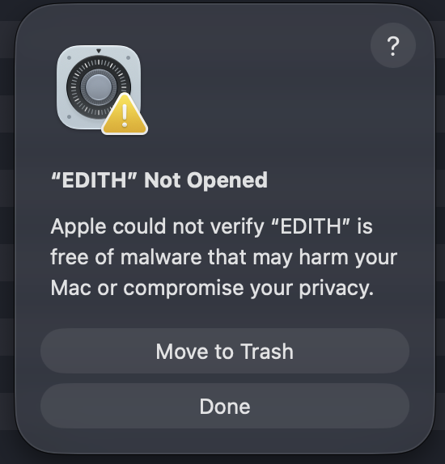

# Bundled desktop runtime

Starting with 0.1.0-alpha.3, the macOS installer runs its own local service. Open EDITH normally; Node.js, npm, Vite, and the repository are not required on the destination Mac.

## Install and open on macOS

1. Download the Apple Silicon `.dmg` from [GitHub Releases](https://github.com/duckfollow/edith/releases). The current installer requires macOS 13.5 or later.
2. Stop any active proxy and quit the previous EDITH version before replacing it.
3. Open the DMG and drag **EDITH** into **Applications**.
4. Open EDITH from Applications.

### “EDITH” Not Opened — Apple could not verify the app

The current alpha build is ad-hoc signed and has **not been notarized by Apple**. macOS Gatekeeper may display **“Apple could not verify ‘EDITH’ is free of malware”** with **Move to Trash** and **Done** buttons. This means macOS cannot verify the downloaded app; it is not a guarantee that the app is safe.



If you downloaded the intended release from this project's GitHub repository, trust its source, and choose to open it, follow these steps yourself:

1. Click **Done** in the warning.
2. Open **System Settings → Privacy & Security**.
3. Scroll to **Security** and find the message about EDITH being blocked.
4. Click **Open Anyway**.
5. Authenticate with your Mac password or Touch ID if prompted, then click **Open** to confirm.

macOS saves an exception for this app. You do not need to disable Gatekeeper for the whole system. If **Open Anyway** is missing, try opening EDITH once more and return to Privacy & Security; a managed Mac may require help from its administrator. If the warning instead says the app **will damage your computer**, do not treat it as the same unsigned-app warning.

See Apple's [Safely open apps on your Mac](https://support.apple.com/en-au/102445) for the official steps. To remove this first-launch obstacle from future distributed builds, the release process needs **Developer ID signing and Apple notarization**; passing local tests or using an ad-hoc signature does not replace those steps.

## Included features

- Local HTTP proxy and optional HTTPS inspection using a locally generated CA.
- Gateway routing, live traffic, and explicitly saved Gateway configurations in SQLite.
- SDK receiver with explicit enable/disable and pairing tokens.
- Local mode without accounts; Management can enable Team mode and create the first Admin directly. Team Admins can switch back to Local mode.
- Existing native System Monitor, macOS System Proxy controls, and certificate setup.

CA trust still requires the user's explicit action in Keychain Access. EDITH does not silently trust certificates. Packet capture remains unimplemented.

## Data and lifecycle

For the default bundle identifier, data lives in `~/Library/Application Support/com.prasi.appsdesktop/`:

| File | Purpose |
| --- | --- |
| `edith.sqlite` | Accounts and saved Gateway configurations |
| `workspace-mode.txt` | Local or Team mode |
| `ca/` | Public CA, private key, and generated leaf certificates |
| `desktop-runtime.log` | Service startup errors and diagnostics |

This is separate from the development `.local/` workspace. Accounts/configurations are not migrated automatically. Never distribute the data directory or CA private key. Back up SQLite only with EDITH stopped.

Proxy/Gateway listeners and SDK ingestion start disabled. Capture history and login sessions are held in memory. Mode changes stop listeners, restore EDITH-managed System Proxy settings, and restart the service; saved accounts/configurations remain. Normal quit restores EDITH-managed System Proxy settings before stopping the service; a restoration error keeps the app running and reports the error. Force-killing the application cannot guarantee network-setting restoration; the saved recovery workflow remains available on the next launch.

The service binds only to `127.0.0.1` on a dynamically assigned port. The frontend uses native IPC; Rust injects a per-launch secret and holds the Team session cookie. The bridge permits only EDITH control paths, GET/POST, bounded text bodies, and the supported control headers. External SDK ingestion separately requires a pairing token. Secrets and cookies are not placed in frontend URLs.

Use the current SDK connection snippet after restarting EDITH or changing modes: its endpoint port and pairing token can change. Existing SDK clients must reconnect using the new snippet. A system HTTP proxy's listening port is configured separately in Proxy settings.

## Build a macOS installer

From the repository root:

```sh
npm ci
npm run build --workspace appsdesktop -- --bundles app,dmg
```

The build hook downloads official Node.js **24.22.1**, verifies its archive SHA-256 against the official release checksum list, and bundles the executable, license, and service sources. Downloads are cached under `node_modules/.cache/edith-runtime`; generated resources under `apps/desktop/src-tauri/runtime` are ignored by Git. Internet access is required to retrieve the checksum list and any missing archive. No Homebrew Node binary or local database/CA is copied into the app.

Build on the target architecture (Apple Silicon or Intel); cross-compiling the bundled runtime is not currently supported. Minimum macOS version is **13.5**, matching the bundled Node binary. Windows/Linux runtime preparation is not implemented.

Installers are under `apps/desktop/src-tauri/target/release/bundle/dmg`. Developer ID signing and Apple notarization must be configured separately for public distribution. A locally ad-hoc signed build is not notarized.

## Validation

```sh
npm run test:desktop
npm run check
cargo test --manifest-path apps/desktop/src-tauri/Cargo.toml --lib
```

Runtime integration tests exercise protected controls, real HTTP forwarding, Gateway routing/configuration persistence, SDK pairing/ingestion, public CA generation/download, Team setup/session enforcement, and listener shutdown. Native tests cover IPC request restrictions and existing system features. A release also needs a smoke test of the actual bundled app without Vite.
